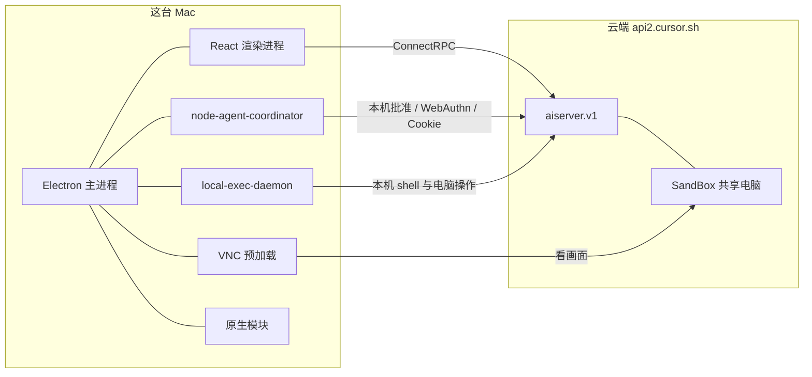

# Grok Bot 本地安装技术结构

范围：本机 `/Applications/Grok Bot.app`，版本 **0.75.0**（`CFBundleIdentifier` `com.anysphere.sand`，内部包名 `sand`）。代码是 Rolldown / Electron 的生产压缩，局部变量被收短，业务名字还在，没有混淆，也没有附带 source map。

这份文档只描述安装包里看得到的进程、模块和接口。云端沙箱（那台共享电脑）的服务端实现不在这个安装包里。用户数据目录只记了文件名，没有打开密钥、Cookie 或会话内容。

## 1. 总图

一个 Electron 进程装界面。机器人、房间、转录、附件、沙箱生命周期都在云端，桌面通过 ConnectRPC 调用 `aiserver.v1`。云电脑的画面用 VNC 嵌回聊天窗口。真正要在这台 Mac 上执行的事，另起两个 Node 子进程：一个跑本机命令，一个把需要人出面的批准送回界面。

## 2. 外壳

| 项 | 值 |
| --- | --- |
| 界面技术 | Electron 42.11.16，Chromium 148.0.7778.280 |
| 主入口 | `dist/electron-main/main.cjs`，再加载 `main-core.cjs`、`main-app.cjs` |
| 打包 | `app.asar`，原生模块在 `app.asar.unpacked` |
| 更新 | Squirrel（`ShipIt`），界面侧有 `checkForUpdates` / `quitAndInstallUpdate` / `setUpdateTrack` |
| 协议 | `grokbot://`、`sand://`，OAuth 回调走 `grokbot://mcp/oauth/callback` |
| 最低系统 | macOS 12，arm64 |
| 版权 | SpaceXAI；依赖是 Anysphere 的 workspace 包 |

主进程文件大约 3.1 MB（`main-app.cjs`）加 0.96 MB（`main-core.cjs`）。界面入口是 `dist/renderer/index.html`，脚本是 `index-*.js`，并预加载 `index.eager-vendor`、`index.eager-platform`、`index.eager-app`。

## 3. 进程

| 进程 | 包内路径 | 职责 |
| --- | --- | --- |
| Electron 主进程 | `dist/electron-main/main*.cjs` | 窗口、自定义协议、更新、托盘、把端口交给渲染进程 |
| 渲染进程 | `dist/renderer/` | 聊天、机器人名单、设置。React |
| VNC / WebView 预加载 | `dist/electron-preload/preload-vnc.cjs`、`preload-webview.cjs` | 云电脑画面、访客网页、通行密钥卡住时的上报 |
| 桌面挂载面板 | `preload-desktop-mount-panel.cjs`、`preload-desktop-mount-capture-overlay.cjs` | 一块可移动的小面板：选项、预览、截取 |
| 头像源 | `preload-avatar-source.cjs` | 把 JPEG 帧解成位图，协议 `sand:avatar-source` |
| 协调器 | `dist/node-agent-coordinator/main.cjs` | 需要这台电脑上的人出面的请求：Cookie 来源批准、WebAuthn、本机工具许可、虚拟卡批准 |
| 本机执行 | `dist/local-exec-daemon/main.cjs` | 本机 shell、本机电脑操作、屏幕录制相关的执行端。日志标签含 `local-exec-daemon`、`shell-exec`、`user-computer-provider` |
| 信息 worker | `dist/local-exec-daemon/messages-worker.cjs` | 查本机「信息」权限 |
| Chrome 导入 worker | `dist/electron-main/chrome-import-worker.cjs` | 从本机 Chrome 导入 Cookie |
| 1Password | `onepassword-connection-service.cjs` | 本机 1Password 连接 |

主进程用 `utilityProcess` 和 `fork` 拉起子进程。协调器连上之后，主进程用 `MessagePort` 把端口交给渲染进程，通道名是 `sand:coordinator-port`。渲染进程不直接 `ipcRenderer.invoke` 一长串通道，而是拿到这个端口上的 bridge。

本机还有两个原生可执行文件：`sand-webauthn-signer`、`sand-op-launcher`。云电脑上的计算机操作另有按平台下发的 sidecar（darwin / windows 的 manifest 在包里，二进制不在这个 app 里）。

## 4. 渲染进程

界面是 React，编辑器 Tiptap，服务端状态 TanStack Query，样式 StyleX，文案 Lingui，公式 KaTeX，图 Mermaid，PDF 用 pdfjs。崩溃上报 Sentry，功能开关 Statsig。拖拽用 dnd-kit。

`index.html` 的 CSP 把连接收在 `https://grok.com` 和 `ws:`，画面和预览用下面这些自定义协议，而不是随便嵌网页：

- `sand-avatar:`、`sand-favicon:`、`sand-media:`
- `sand-html-preview:`、`sand-canvas:`、`sand-mcp-app:`、`sand-visualization:`

打包块的名字能看出界面模块：`chat`、`agents`、`group`、`computer`、`box`、`automation`、`marketplace`、`mcp`、`connector`、`onepassword`、`finance`、`library`、`onboarding`、`settings`、`cloud`。代码高亮语言包是 Shiki 拆出来的块，不是产品模块。

渲染进程暴露给页面的对象：

| 全局对象 | 作用 |
| --- | --- |
| `desktop` | 主桥。`desktop.main` 是大约 380 个方法的调用表，`desktop.boot` 是启动快照，`desktop.local` 只做缩放、附件落盘、启动门闩 |
| `coordinatorPort` | 协调器的 MessagePort |
| `sandRenderTrace` | 渲染耗时，送给可靠性上报 |
| `desktopMount` | 挂载面板自己的小桥：读布局、提交提示、切换机器人、拖面板 |

启动顺序从通道名能看出来：`sand:boot-snapshot-sync`（同步拿到启动快照）→ `sand:renderer-boot-gate-opened` → `sand:renderer-boot-gate-landed` → `sand:renderer-alive`。断网恢复走 `sand:network-online`。

`desktop.main` 按能力分成这些组（名字是桥上的方法，不是云端 RPC）：

- 窗口：最小化、最大化、关窗、标题栏、主题、语言、硬件加速、拼写
- 电脑：`setComputerViewOpen`、`signalBoxIntent`、`forceRecreateComputer`、升级排期、`forceReconnectGateway`、`reportVncSession`、`reportVncLiveness`
- 账号：Cursor 登录、多账号切换、团队、用量、隐私模式、试用
- 机器人：创建、改名、声音、可见性、分享、技能、插件、文件、记忆、邮件收件箱、密钥
- 房间：`addGrokBotRoomPeople`、`removeGrokBotRoomPeople`
- 批准：本机工具许可、自动审查说明、凭证请求、1Password、通行密钥、支出
- 连接器：MCP 服务器、Slack、Teams、财务账户、Chrome Cookie 导入
- 持久化：`readClientPersistence` / `writeClientPersistence`，对应磁盘上的 `sand-client-persistence`

## 5. 云端协议

生成代码在 `dist/electron-main/proto.cjs`（约 1.3 MB）。服务都在 `aiserver.v1`。桌面默认打到 `api2.cursor.sh`；只有显式配置了别的 `SAND_BACKEND_URL` 或 `CURSOR_API_BASE_URL` 才离开这个主机。传输是 ConnectRPC（`@connectrpc/connect`）加 Protobuf。

七个服务：

| 服务 | 桌面用它做什么 |
| --- | --- |
| `GrokBotService` | 机器人、房间、转录、附件、密钥、邮件、模板、市场、Slack/Teams。方法最多 |
| `SandBoxService` | 共享电脑本身：创建、窗口、存储清单、升级、休眠、迁移、1Password 连接 |
| `DashboardService` | 团队、账单、MCP 配置、机器登记、Canvas、插件市场 |
| `BackgroundComposerService` | 云端后台代理的会话、产物、和 Dashboard 重叠的一批账号方法 |
| `AgentStoreService` | 代理文件库：列目录、读写、锁、分享、预签名上传 |
| `AiService` | 模型列表、生图、语音转写、语音合成、给标签起名 |
| `AnalyticsService` | 事件、Statsig 引导、日志、会话回放 |

`GrokBotService` 里和产品结构直接相关的方法族：

- 机器人：`CreateGrokBotAgent`、`ListGrokBotAgents`、`SetGrokBotMainAgent`、`UpdateGrokBotAgent`、`SetGrokBotAgentVoice`、`DeleteGrokBotAgent`
- 说话：`SendGrokBotUserMessage`、`SendGrokBotAgentMessage`、`WatchGrokBotTranscripts`、`CommitGrokBotTranscriptEntries`、`InterruptGrokBotAgentRun`
- 房间：`CreateGrokBotRoom`、`SetGrokBotRoomMembers`、`RequestGrokBotRoomMemberTurn`、`DeliverGrokBotRoomMemberTurnResult`、`CancelGrokBotRoomMemberTurn`
- 人要出面的请求：`WatchGrokBotUserComputerRequests`、`SubmitGrokBotUserComputerResponses`、`ResolveGrokBotLocalToolPermission`、`ResolveGrokBotCredentialRequest`、`SubmitGrokBotSecret`、`RespondGrokBotWidget`
- 做完一件事：`ListGrokBotAgentTasks`、`MarkGrokBotAgentTaskDone`、`ListGrokBotAgentTodos`、`NotifySandAgentTurnFinished`
- 自动化：`ListGrokBotAgentAutomations`、`ListGrokBotAgentRoutines`，各自有启用开关

房间这一侧是「向某个成员要一轮，再把这一轮的结果交回来」，不是把群本身当成一个说话人。

## 6. 两台电脑

包里把「电脑」拆成两套，不要混。

**云电脑（SandBox）**

- 账号级的一台共享电脑。`EnsureSandBox`、`ListSandBoxes`、`GetSandBoxRunState` 管它的生命周期
- 每个机器人有自己的窗口：`EnsureSandBoxWindow`
- 文件在对象存储上，用预签名上传和一份清单：`PresignSandBoxStoreWrites`、`CommitSandBoxStoreManifest`
- 升级可以预约、改期、取消：`GetSandBoxUpgradeSchedule`、`ScheduleSandBoxUpgrade`
- 画面不进 React 树里画，而进一个 VNC 会话。预加载上报 `sand:vnc-session`、`sand:vnc-liveness`、`sand:vnc-interactive`、`sand:vnc-accepts-input`、`sand:vnc-viewer-visible`，剪贴板镜像走 `vnc-clipboard-mirror`
- 人要接管时，桌面发 `EndGrokBotBoxHandoff` 这一类调用；输入是否被接受由 VNC 通道告诉界面

**这台 Mac（User Computer）**

- `IssueGrokBotUserComputerCredential` 发给这台机器一个身份，`ListGrokBotUserComputers` 列出已登记的机器
- 云端要在这台机器上做事时，桌面 `WatchGrokBotUserComputerRequests` / `PollGrokBotUserComputerRequests`，做完 `SubmitGrokBotUserComputerResponses`
- 真正执行在 `local-exec-daemon`。许可分本地工具许可、Cookie 来源、WebAuthn、信息 app 收件人、电脑操作允许的 app
- 屏幕捕获、窗口列表在原生模块 `sand-window-capture`，不在云电脑里

所以：聊天里看到的桌面是云电脑的 VNC；「在你这台电脑上运行」是另一条许可和另一个进程。

## 7. 本机原生模块

都在 `app.asar.unpacked/dist/deps/`，是编译好的 `.node`，没有 JavaScript 逻辑可看。

| 模块 | 导出 |
| --- | --- |
| `sand-window-capture` | 屏幕录制权限、列出窗口、按窗口截图 |
| `sand-card-text-recognition` | 图片文字识别（银行卡拍照） |
| `sand-devicecheck` | DeviceCheck 令牌，以及是否跑在虚拟机里 |
| `sand-notification-settings` | 系统通知权限；Windows 上还能读设备管理策略 |
| `cursor-proclist` | 进程树。每条记录带 pid、父 pid、名字、CPU、内存、argv，以及 `ownerAgentId` |
| `tree-sitter` / `tree-sitter-bash` | 本机解析，含 bash |
| `sand-webauthn-signer` | 通行密钥签名的原生程序 |
| `sand-op-launcher` | 拉起 1Password |

## 8. 本机落盘

用户数据在 `~/Library/Application Support/Grok Bot`。和产品状态有关的是这些名字：

| 路径 | 是什么 |
| --- | --- |
| `sand-client-persistence/` | 界面状态，一串 blob。桥上的 `readClientPersistence` 读写这里 |
| `sand-secrets.json` | 密钥文件。本文没有打开 |
| `desktop-status.json` | 进程是否还活着：版本、pid、启动时间、是否已登录 |
| `window-state.json` | 窗口位置和是否最大化 |
| `sand-statsig-bootstrap.json` | 功能开关引导 |
| `sand-update-apply-marker.json`、`sand-update-kept/` | 更新 |
| `Partitions/sand-forever-box/` | 一块独立的 Chromium 分区，给长期存活的网页用 |
| `attachment-image-cache/`、`link-favicon-cache/`、`link-preview-cache/`、`plugin-logo-cache/` | 各类图片缓存 |
| `dune-reliability/sessions/` | 渲染可靠性会话 |
| `sentry/` | 崩溃队列 |

日志目录名是 `~/Library/Logs/com.anysphere.sand`。主进程在用户数据目录旁边还会写 `local-exec-daemon.json`、`local-exec-daemon-connection.json`、`local-exec-daemon-credential.json`，给本机执行进程发现和对接用。

## 9. 安装包里没有的东西

- 云电脑里的操作系统、浏览器配置和代理运行时。桌面只持有 VNC 会话和 SandBox 的 RPC
- 机器人之间「谁下一句说话」的判定。房间 RPC 只有请求一轮、交回一轮、取消一轮
- 可还原的 TypeScript 源码。业务名字在，函数体是压缩后的单行
